# Rounds: doctor call scheduling

Rounds books 30–45 minute video calls between patients and doctors. Patients say **when they are free** (a time window) and **when they would prefer**. Rounds instantly places the call in the slot that best balances four goals:

| Goal | How Rounds gets there |
|---|---|
| Keep each doctor about **80% booked** | Range-based requests, demand steering, gap-free packing, load balancing |
| Patients get a slot **quickly** and **at a time they want** | Instant placement (no batch job), three confirmed options in under a second |
| Doctors can **take leave and block time** | Affected calls are moved automatically, in the patient's own window |
| **Fewer no-shows** | Strike policy with refundable deposits, waitlist auto-fill, calendar export |
| **Per-doctor analytics** on all of the above | Utilization, no-shows, preference match, lead time, overruns, dead gaps, capacity hints |

Built with **Next.js 16** (App Router, React 19, Tailwind CSS 4) and **FastAPI** (SQLAlchemy 2, Pydantic 2, SQLite).

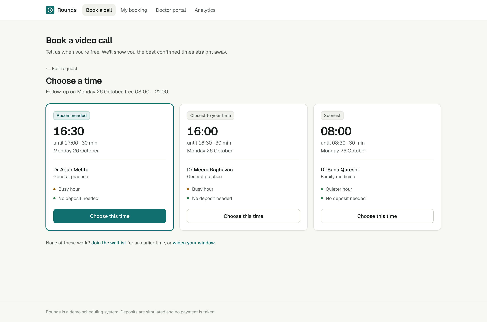

---

## Contents

1. [Quick start](#quick-start)
2. [Features](#features)
3. [How scheduling works](#how-scheduling-works)
4. [Reducing no-shows](#reducing-no-shows)
5. [Leave and availability changes](#leave-and-availability-changes)
6. [Analytics: metric definitions](#analytics-metric-definitions)
7. [Does it work? The simulator](#does-it-work-the-simulator)
8. [Architecture](#architecture)
9. [Data model](#data-model)
10. [API reference](#api-reference)
11. [Testing and quality](#testing-and-quality)
12. [Design decisions and trade-offs](#design-decisions-and-trade-offs)
13. [Future improvements](#future-improvements)
14. [Screenshots](#screenshots)

---

## Quick start

**Requirements:** Python 3.11+, Node 20+, pnpm.

```bash
make setup     # creates api/.venv, installs Python and web dependencies
make seed      # creates the SQLite database: 6 doctors and 4 weeks of replayed history
make dev       # API on http://localhost:8000, web app on http://localhost:3000
```

Open <http://localhost:3000>. Interactive API docs are at <http://localhost:8000/docs>.

There are no accounts in the MVP. The header links to each area: **Book a call** (patient), **My booking** (lookup by reference), **Doctor portal**, **Analytics**.

<details>
<summary>Without make</summary>

```bash
# API
cd api
python3 -m venv .venv && .venv/bin/pip install -e ".[dev]"
.venv/bin/python -m scripts.seed
.venv/bin/uvicorn app.main:app --reload --port 8000

# Web (second terminal)
cd web
pnpm install
pnpm dev
```
</details>

### Configuration

| Variable | Where | Default | Purpose |
|---|---|---|---|
| `DATABASE_URL` | api | `sqlite:///./rounds.db` | SQLAlchemy URL |
| `CLINIC_TZ` | api | `Asia/Kolkata` | Clinic timezone. All times are clinic-local |
| `CORS_ORIGINS` | api | `http://localhost:3000,...` | Allowed web origins |
| `NEXT_PUBLIC_API_URL` | web | `http://127.0.0.1:8000` | API URL used by the browser |
| `API_URL` | web | (falls back to the above) | API URL used by server components |

All scheduling policy numbers (scoring weights, the 80% target, strike thresholds, deposit amount, hold length) live in one file: [`api/app/config.py`](api/app/config.py).

---

## Features

### Patients
- **Availability as a window, not a slot.** Drag across a day timeline to mark one or more windows, or use presets (Morning, Afternoon, Evening, Any time). Busy hours are shaded, so patients can see which times are contested.
- **Preferred time** inside the window, a visit type (follow-up 30 min, new consultation 45 min) and an optional "I'm flexible on the day" (also searches the next two days).
- **Three confirmed options instantly**, each labelled with why it was suggested: *Recommended*, *Closest to your time*, *Soonest*. Cards show whether the hour is busy and whether a deposit applies.
- **5-minute hold** while the patient confirms, so two people can't take the same slot.
- **Booking page** (by 8-character reference): add to calendar (`.ics`), change time, cancel (with a clear late-cancel warning).
- **Waitlist** when nothing fits the window: the patient is booked automatically as soon as a slot opens inside it.
- If a doctor becomes unavailable, the booking page explains what changed. When no alternative existed, it offers new times straight away.

### Doctors
- **Day timeline** with booked, free, closed and blocked time. Dead gaps (free time too short to book) and utilization against the 80% target are shown for the day.
- **Record outcomes:** start, complete, mark no-show. Deposits settle automatically.
- **Leave** (whole day) and **blocked time** (part of a day), with an immediate summary of how affected calls were handled.
- **Weekly hours editor** with multiple blocks per day (for breaks). Calls that fall outside new hours are moved.

### Analytics
- Clinic overview and a page per doctor, for the last 7, 28 or 90 days.
- Utilization over time against the target line, a weekday × part-of-day heatmap, preference match, no-shows, late cancellations, lead time, call length and overruns, dead gaps, waitlist fills, leave and reassignment counts.
- **Capacity suggestions**, e.g. *"Wed evenings are 100% booked. Adding hours here would absorb demand."*

---

## How scheduling works

### Why not a daily batch schedule?

A batch optimizer that builds each day's schedule at a cutoff packs well, but patients wait hours to find out when their call is. It also conflicts with "users should get their slots quickly". Rounds places every request **instantly**. Good packing comes from the scoring function, not from deferring the decision.

### Why ask for a window instead of an exact slot?

Most patients want an afternoon slot. With exact-slot booking, afternoons fill first and mornings stay empty, so utilization stalls well below 80%. That happens even though many of those patients *could* have done 11:30.

A window tells the scheduler how flexible each patient really is. That lets it **spend scarce peak slots on the patients who can only make peak times** and steer flexible patients to quieter hours. The UI encourages wider windows: they get faster results, and quiet hours never need a deposit.

### The placement algorithm

Code: [`api/app/scheduler/engine.py`](api/app/scheduler/engine.py). It is pure Python with no database or framework imports, so it is easy to test and to simulate.

1. **Capacity.** For each doctor and requested day: free time = working hours − leave/blocks − existing bookings.
2. **Candidates.** Every start on a 15-minute grid where the call fits a doctor's free time *and* the patient's window, after the current time plus 15 minutes' notice.
3. **Score** each candidate. Lower is better:

| Term | Formula (weight in `config.py`) | Why |
|---|---|---|
| Preference | `1.0 × hours from preferred time` | Patients get what they asked for |
| Fragmentation | `1.2 × Σ gap cost` for the gap left on each side: 0 if the call touches a booking or shift edge, **1.0 if the gap is under 30 min** (dead time nobody can book), 0.15 otherwise | Keeps days dense; dead gaps are lost capacity |
| Demand | `1.6 × demand index × flexibility`, where flexibility = min(1, (window minutes − call length) / 240) | Flexible patients are nudged off peak; patients with narrow windows pay nothing for peak slots |
| Load | `1.0 × doctor utilization after booking`, plus `6 × excess above 90%` | Spreads work so every doctor approaches 80% rather than one at 100% and another at 50%. The 90% soft cap protects against burnout |
| Lead time | `0.6 × days until the call` | Earlier wins ties: faster care |
| Outside window | `3.0` flat | Only used for fallback options |

4. **Options.** The best score is *Recommended*. The option *Closest to your time* and the *Soonest* option are added when they differ, so the patient has a real choice. Several doctors free at the same time collapse into one option, the best-scoring doctor.
5. **Fallback.** If nothing fits inside the window, the nearest slots up to 2 hours outside it are offered, clearly marked, alongside the waitlist.

#### Worked example

A 30-minute follow-up, window 09:00–18:00, preferred 14:30. Afternoon demand index 1.0, morning 0.2. Flexibility = min(1, (540 − 30)/240) = 1.

| Slot | Preference | Demand | Total (other terms equal) |
|---|---|---|---|
| 14:30 | 0.0 | 1.6 × 1.0 = 1.60 | **1.60** |
| 13:30 | 1.0 | 1.6 × 0.2 = 0.32 | **1.32** ← recommended |

The patient is offered 13:30 as *Recommended* and 14:30 as *Closest to your time*. A patient whose window is only 14:00–15:30 has flexibility 0.25, so the demand term barely applies and they get 14:30. Peak capacity goes to the person who needs it.

### Demand forecast

[`api/app/scheduler/demand.py`](api/app/scheduler/demand.py) keeps a demand index (0–1) per weekday and 15-minute cell. It blends a **prior** (quiet mornings, peak late afternoon) with **recent requests**: half of each request's weight is spread across its window, and half sits on its preferred time. With few requests the prior dominates. After about 20 requests per weekday, real history takes over. The same index shades busy hours in the booking UI and decides which slots count as "peak".

### Concurrency

A chosen option is **re-validated inside the write transaction** before the hold is created. SQLite connections open transactions with `BEGIN IMMEDIATE`, so the availability check and the insert form one critical section. A test fires six concurrent holds at the same slot and asserts that exactly one succeeds.

---

## Reducing no-shows

Without reminders (out of scope for this website-only MVP), the levers are commitment, cost and refilling.

| Mechanism | Rule | Rationale |
|---|---|---|
| **Strikes** | No-show = 1 strike, cancelling within 2 h = 0.5. Rolling 90 days | Past behaviour is the best single predictor of no-shows |
| **Deposit tiers** | < 1 strike: none · 1–2: busy-hour slots only · 2–4: every slot · ≥ 4: same-day quiet slots only, with a deposit | Proportionate. Most patients never see a deposit |
| **Deposit settlement** | Refunded after the call or on a timely cancellation; kept on a no-show or late cancellation | Skin in the game only for patients with a history |
| **Quiet hours waive deposits** for 1-strike patients | Steers riskier patients to hours where a missed call costs least | Also pushes demand toward the hours that need filling |
| **Waitlist auto-fill** | On any cancellation or freed capacity, waiting patients whose window fits are booked first come, first served | A cancelled slot becomes a booked slot instead of dead time |
| **Calendar export** | `.ics` download on every confirmed booking | The patient's own calendar reminds them, with no notification system needed |
| **Late-cancel friction** | The UI states the consequence before a late cancellation | Encourages early cancellation, which the waitlist can refill |

The policy is written as pure functions in [`api/app/services/policy.py`](api/app/services/policy.py). Deposits are **simulated** (no payment provider); the booking stores `deposit_status`, which moves through `pending → held → refunded/forfeited`.

---

## Leave and availability changes

When a doctor adds leave or blocked time, or changes weekly hours, every upcoming call that no longer fits is re-placed ([`api/app/services/reflow.py`](api/app/services/reflow.py)):

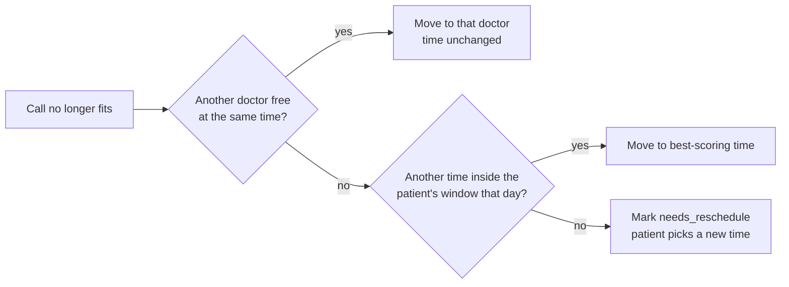

The patient's booking page explains what happened. The doctor sees a summary such as *"2 calls moved to another doctor at the same time, 1 patient asked to pick a new time"*. Removing leave reopens capacity, which goes to the waitlist first.

---

## Analytics: metric definitions

| Metric | Definition |
|---|---|
| **Time booked (utilization)** | Booked minutes ÷ open minutes. Open = working hours − leave/blocks. Booked includes confirmed, in-progress, completed **and no-show** calls, since a no-show still used the slot |
| **Realised utilization** | Completed minutes ÷ open minutes |
| **Days at target** | Doctor-days with utilization ≥ 80% |
| **No-show rate** | No-shows ÷ (completed + no-shows) |
| **Late-cancel rate** | Cancellations within 2 h ÷ bookings confirmed |
| **Preference match** | Share of calls at the preferred time (± 30 min), elsewhere in the window, or outside it |
| **Lead time** | Hours from the patient's request to the call start (median, and share within 24 h) |
| **Overrun rate** | Completed calls that ran more than 5 minutes over |
| **Dead gap** | Free time between bookings shorter than 30 minutes, i.e. unbookable |
| **Next 7 days** | Share of the coming week's open time already booked |
| **Capacity suggestions** | Weekday × part-of-day blocks (≥ 4 h open in the period) under 50% booked (consider moving hours) or over 95% (consider adding hours) |

Hitting 80% is not only about getting more bookings. Sometimes it means **opening fewer hours where demand is thin**, and the heatmap and suggestions show where.

---

## Does it work? The simulator

[`api/scripts/simulate.py`](api/scripts/simulate.py) replays the same synthetic demand through three strategies. Afternoon-heavy preferences, windows from 75 minutes to 10 hours, 55/45 follow-ups and new consultations, and requests arriving in random order.

```
$ make simulate
10 weekdays, demand = 100% of capacity

strategy   utilisation  util p10  placed at pref. narrow placed dead gap/day
----------------------------------------------------------------------------
rounds           84.3%     71.4%   88.7%    81.4%         80.6%        5.9 m
first-fit        80.3%     62.5%   84.9%    16.0%         75.9%       30.5 m
closest          80.8%     67.9%   85.5%    82.8%         75.3%       29.2 m
```

- **rounds**: this scheduler, with the patient taking the recommended option.
- **first-fit**: the earliest free slot in the window (typical of simple booking systems).
- **closest**: the free slot nearest the preferred time (what exact-slot booking amounts to).

The scoring engine books **4 points more of doctors' time** and places **more requests**. It serves **5 points more patients with narrow windows**, and leaves **5× less dead time** per doctor-day. It matches preferred times almost as often as "closest", which optimizes for nothing else. The bottom 10% of doctor-days also improves (`util p10`), which is the load-balance term at work. Try `--load 0.9` or `--load 1.2` for lighter and heavier demand; the ranking holds.

The seed script ([`api/scripts/seed.py`](api/scripts/seed.py)) replays about 1,500 synthetic patients through the **real services** in time order: requests, holds, deposits, cancellations, leave, waitlist and outcomes. The seeded clinic lands at about **81% utilization**, with every analytics number produced by the actual code paths.

---

## Architecture

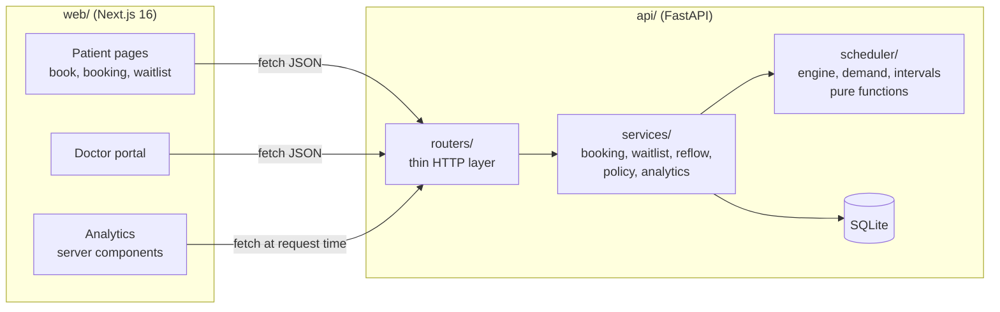

- **Routers** validate input (Pydantic) and map domain errors to HTTP codes. They contain no business rules.
- **Services** hold the business rules and own transactions. `placement.py` is the single bridge to the engine, so booking, waitlist and leave flows apply identical rules.
- **Scheduler** is pure and deterministic. It is unit-tested on its own and reused unchanged by the simulator.
- **Web**: analytics and the doctor list are server components streamed behind Suspense. Interactive flows are client components using a small typed client ([`web/lib/api.ts`](web/lib/api.ts)) and a `useApi` hook. API types are mirrored in [`web/lib/types.ts`](web/lib/types.ts).

```
doctor-scheduler/
├── api/
│   ├── app/
│   │   ├── config.py          all policy numbers and scoring weights
│   │   ├── models.py          SQLAlchemy models
│   │   ├── schemas.py         request/response models
│   │   ├── scheduler/         engine.py · demand.py · intervals.py   (pure)
│   │   ├── services/          placement · booking · waitlist · reflow · policy · analytics · calendar
│   │   └── routers/           patients · doctors · analytics · presenters
│   ├── scripts/               seed.py · simulate.py
│   └── tests/                 engine, intervals, policy, booking flow, availability, analytics
├── web/
│   ├── app/                   routes: /, /book, /booking/[code], /waitlist/[code], /doctor/[id], /analytics/[id]
│   ├── components/            booking/ · doctor/ · analytics/ · ui/ (design-system primitives)
│   └── lib/                   api client, types, formatting, useApi
├── docs/screenshots/
└── Makefile
```

---

## Data model

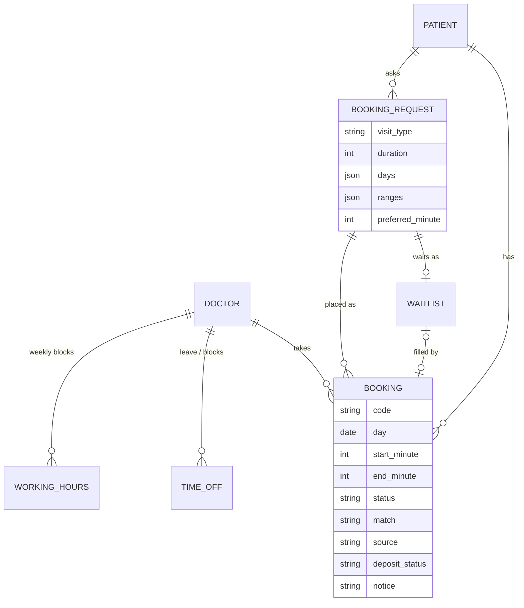

Times are stored as **a date plus minutes from midnight in clinic time**, which is the grid the scheduler reasons in. The `BookingRequest` is kept for every booking. That lets a call be re-placed *inside the patient's own window* when a doctor takes leave, and it feeds the demand forecast.

Booking statuses: `held → confirmed → in_progress → completed`, or `no_show`, `cancelled`, `needs_reschedule`.

---

## API reference

Full interactive docs: `http://localhost:8000/docs`. Errors share one shape: `{"error": {"code": "slot_unavailable", "message": "..."}}`.

| Method | Path | Purpose |
|---|---|---|
| `POST` | `/booking-requests` | Submit window + preference → up to 3 scored options and deposit policy |
| `POST` | `/bookings` | Hold a chosen option for 5 minutes (re-validated) |
| `POST` | `/bookings/{code}/confirm` | Confirm, paying the simulated deposit if required (`402` otherwise) |
| `GET` | `/bookings/{code}` | Booking details and allowed actions |
| `POST` | `/bookings/{code}/cancel` | Cancel; late cancellations recorded; waitlist refilled |
| `GET` | `/bookings/{code}/reschedule-options` | New options within the original window |
| `POST` | `/bookings/{code}/reschedule` | Move to a chosen option |
| `GET` | `/bookings/{code}/calendar.ics` | Calendar file |
| `POST` | `/waitlist` · `GET /waitlist/{code}` · `POST /waitlist/{code}/leave` | Waitlist |
| `GET` | `/demand?day=` | Demand profile for shading busy hours |
| `GET` | `/doctors` | Doctors with today's utilization |
| `GET` | `/doctors/{id}/schedule?day=` | Day schedule and stats |
| `POST` | `/doctors/bookings/{id}/outcome` | `start` · `complete` · `no_show` |
| `GET/PUT` | `/doctors/{id}/hours` | Weekly hours (PUT re-places conflicting calls) |
| `GET/POST` | `/doctors/{id}/time-off` | Leave and blocks (POST re-places conflicting calls) |
| `DELETE` | `/doctors/{id}/time-off/{id}` | Remove; freed time goes to the waitlist |
| `GET` | `/analytics/overview?days=` | Clinic KPIs, daily series, per-doctor KPIs |
| `GET` | `/analytics/doctors/{id}?days=` | Doctor KPIs, daily series, heatmap, suggestions |

---

## Testing and quality

```bash
make test        # 44 API tests
make lint        # ruff + ESLint + Prettier
make typecheck   # mypy --strict + tsc
make check       # all of the above
```

- **Engine tests** (pure): stays inside windows and on the grid, never overlaps, avoids dead gaps, steers wide windows off peak while narrow windows keep peak, balances load, respects current time and notice, falls back outside the window, returns distinct labelled options.
- **Flow tests** (HTTP, against a temp SQLite file with a pinned clock): request → hold → confirm; double-booking conflicts; **six concurrent holds → exactly one wins**; hold expiry; deposit tiers and settlement; no-show guard; late-cancel strikes; waitlist auto-fill on cancellation; multi-day search.
- **Availability tests**: leave → same-time reassignment; block → new time inside the window; no capacity → `needs_reschedule` → patient reschedules; removing leave; hours changes.
- **Analytics tests**: utilization, realized utilization, no-show and overrun rates computed from known outcomes.
- The API passes `mypy --strict`. The web app passes `tsc` (strict), ESLint (including React Compiler rules) and Prettier.

---

## Design decisions and trade-offs

| Decision | Why | Trade-off |
|---|---|---|
| **Instant placement** instead of a daily batch | Patients get a confirmed time immediately | Each placement is greedy. A batch could pack slightly tighter, but the scoring terms recover most of that (see simulator) |
| **Windows instead of exact slots** | Reveals flexibility, which is what makes 80% reachable without forcing everyone into afternoons | Slightly more input from the patient; presets keep it to one tap |
| **Three options, recommended first** | Choice increases commitment; "closest" and "soonest" keep the patient in control | Some patients will always pick "closest", which weakens steering. Deposit waivers on quiet hours push back |
| **Hold, then confirm** | Prevents two patients taking the same slot while one pays | A hold briefly takes capacity; it expires after 5 minutes |
| **SQLite** with `BEGIN IMMEDIATE` | Simplest setup with correct serialization | Writers are serialized. For production, use Postgres with an exclusion constraint on `(doctor, tsrange)` |
| **No auth** | MVP scope; patients are identified by email, bookings by an unguessable 8-character code | The doctor portal and analytics are open. Add auth with roles before real use |
| **Simulated deposits** | Demonstrates the policy end to end | Needs a payment provider (Stripe or Razorpay authorisations) for production |
| **Single clinic timezone** | Every doctor and patient works on one wall clock | Multi-timezone support needs UTC storage and per-user display |
| **Pure engine** with injected clock and demand | Testable, simulatable, explainable (score breakdown is returned with each option) | Slight duplication between engine types and ORM models |

---

## Future improvements

1. **Smart overbooking.** Predict each booking's no-show probability (strikes, lead time, time of day) and allow a small, bounded overbook on slots where expected attendance is low.
2. **Reminders and confirm/release.** SMS or WhatsApp at 24 h and 2 h with a one-tap "I'll be there / release my slot". This is the single largest no-show lever, and was excluded from this website-only MVP.
3. **Re-optimisation of unconfirmed holds**, or periodic swaps for patients who opt in ("move me earlier if something opens").
4. **Learned scoring weights**, tuned per clinic from historic data with the simulator as the objective.
5. Real payments, authentication and roles, Postgres, and multi-timezone support.

---

## Screenshots

| | |
|---|---|
| 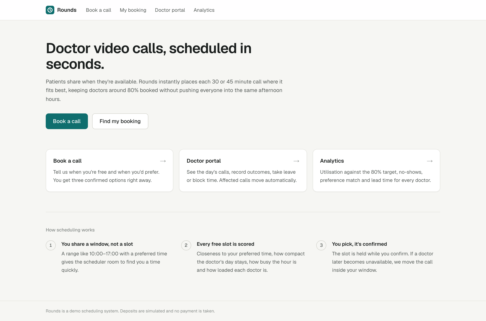 | 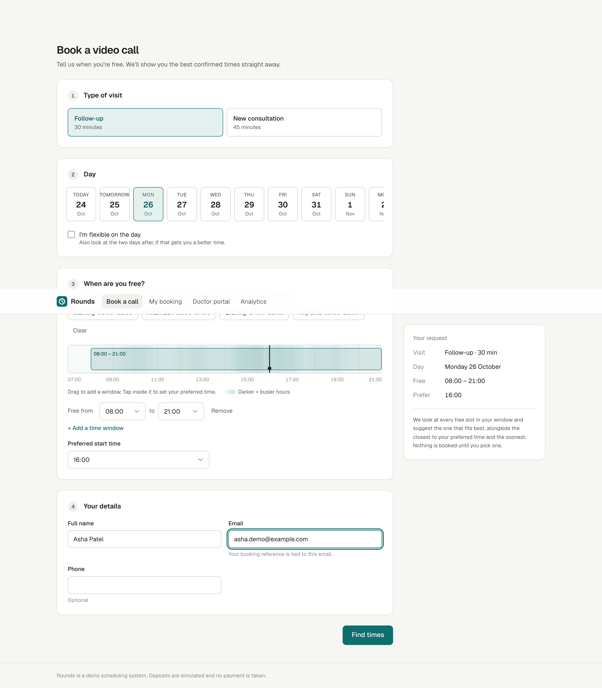 |
| Home | Booking form with the drag-to-select window and busy-hour shading |
|  | 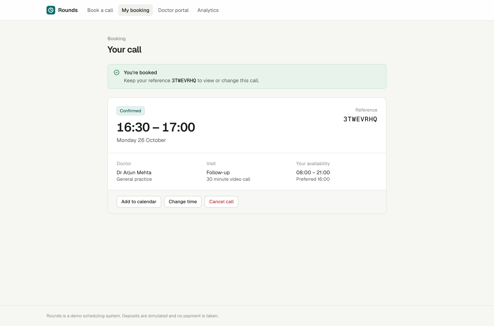 |
| Three scored options | Confirmed booking |
| 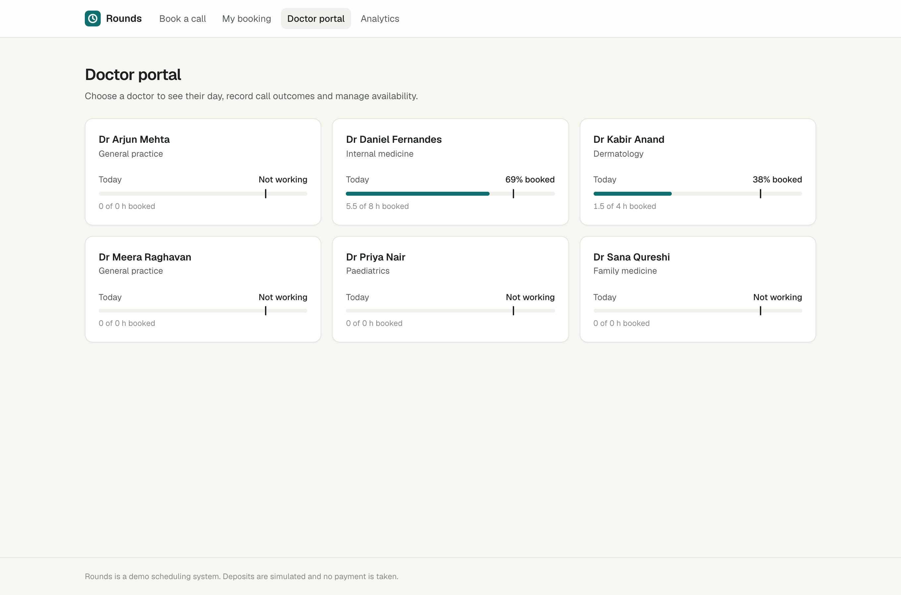 | 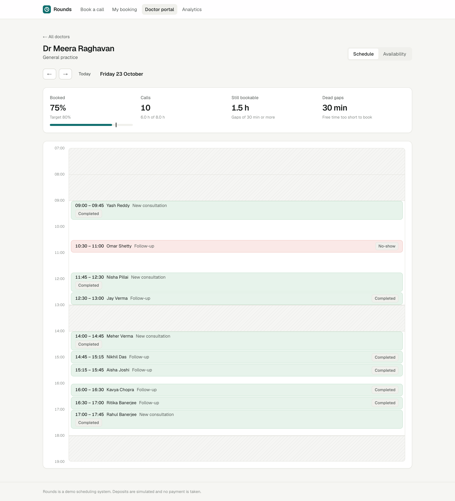 |
| Doctor list with today's utilization | Doctor day timeline with outcomes |
| 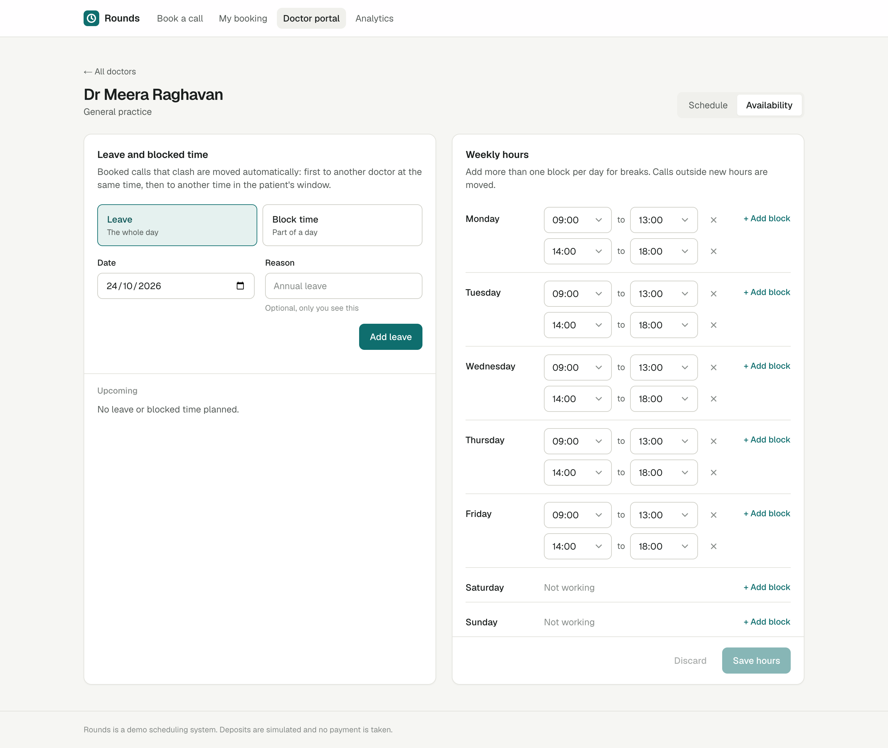 | 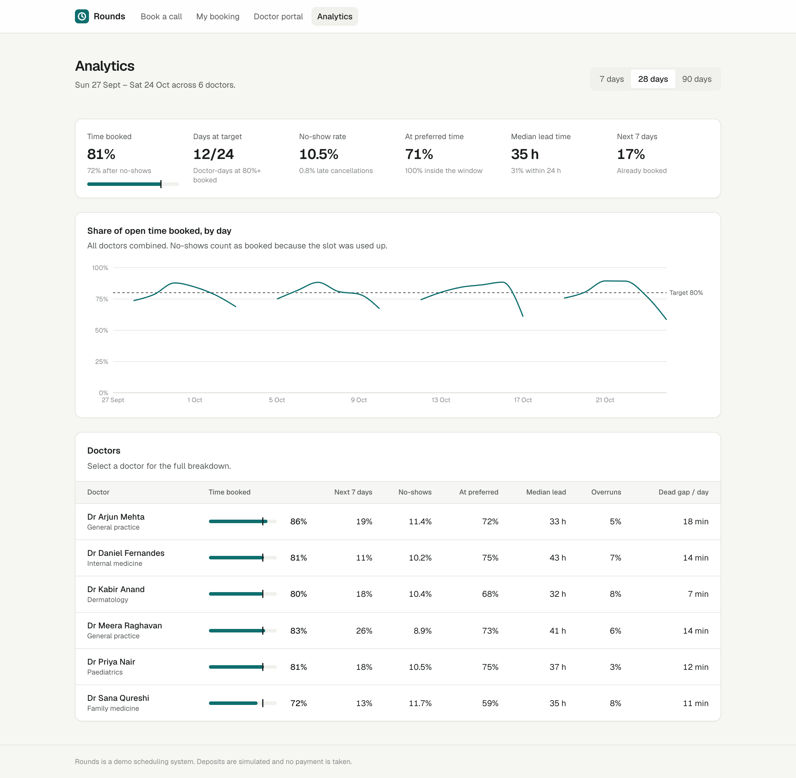 |
| Leave, blocks and weekly hours | Clinic analytics |
| 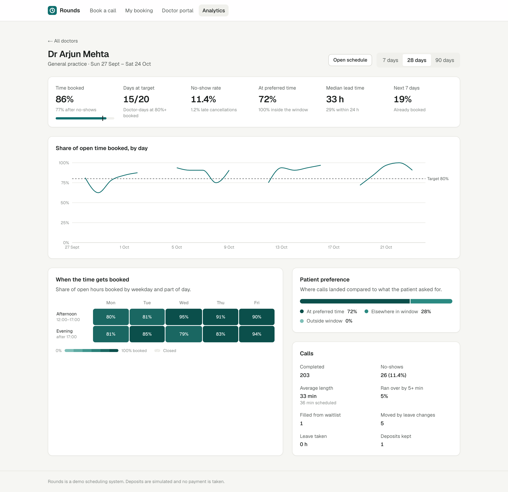 | 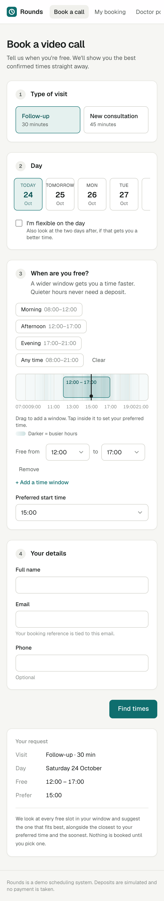 |
| Per-doctor analytics | Mobile booking |
